# Piholegotchi

An old Pwnagotchi, rebuilt as a face for my network's ad blocker.

A Raspberry Pi Zero W sits on the shelf and reads stats from [AdGuard Home](https://adguard.com/en/adguard-home/overview.html), which runs on a ZimaOS home server. Its 2.13in e-ink screen shows two things:

- **Sleeve** while Spotify is playing: the album cover, dithered to 1-bit, with track, artist and progress.
- **Muncher** the rest of the time: a small creature that eats the ads AdGuard Home blocks. Its mood follows the day's block rate.

<p>
  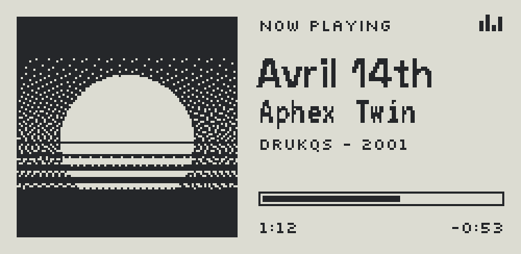
  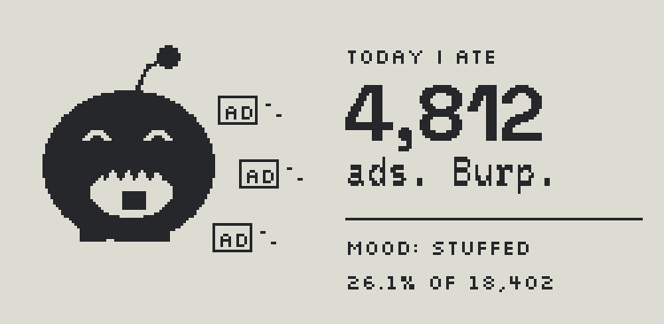
</p>

## Design

The panel is 250 × 122 pixels, black or white, with no greys. Every screen is drawn at that native size, so what you see above is exactly what the panel shows, scaled up 3×.

- **Type.** Silkscreen for small caps labels, VT323 for secondary lines, Space Grotesk Bold for the big numbers and titles. All three hold up when thresholded to 1-bit.
- **Album art.** Atkinson dithering. It keeps more white than Floyd–Steinberg, so covers stay light and readable on paper-white e-ink.
- **Refresh.** E-ink flashes black and white on a full refresh. The progress bar uses quick partial refreshes every 10 seconds, and a full refresh only happens on a track change, a mood change, or every 30 partials to clear ghosting.
- **Settings page.** A small web page on the Pi with a live view of the screen, so setup needs no SSH after install.
- **Switching.** When Spotify stops, a paused track stays up for 2 minutes, then Muncher and the other screens take turns (every 2 minutes by default). While music plays, bins and reminders can cut in for a minute, at most every 10 minutes. Both are settings.
- **Stats.** Muncher counts what AdGuard Home blocked over its stats window (24 hours by default), checked every 5 minutes.

### Muncher's moods

| Block rate | Mood | |
|---|---|---|
| under 12% | Hungry | 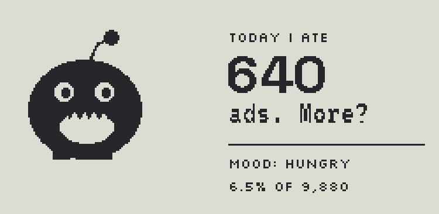 |
| 12–22% | Content | 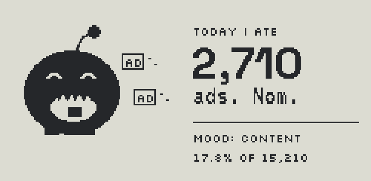 |
| over 22% | Stuffed |  |
| AdGuard down | Asleep | 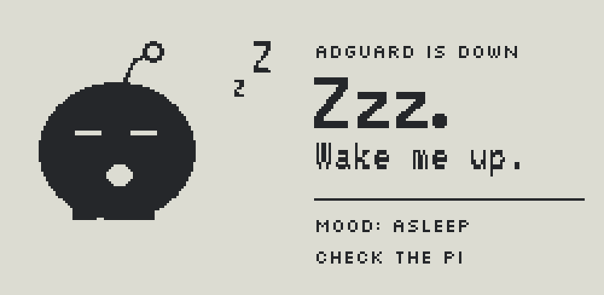 |

### More screens

Each has three styles, picked on the settings page. Bins and reminders only show when something's due.

| | A | B | C |
|---|---|---|---|
| Server health | 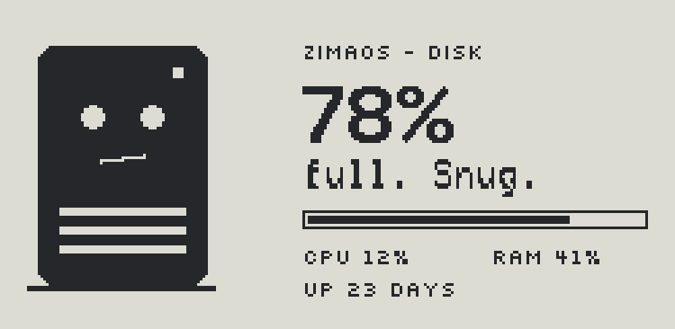 | 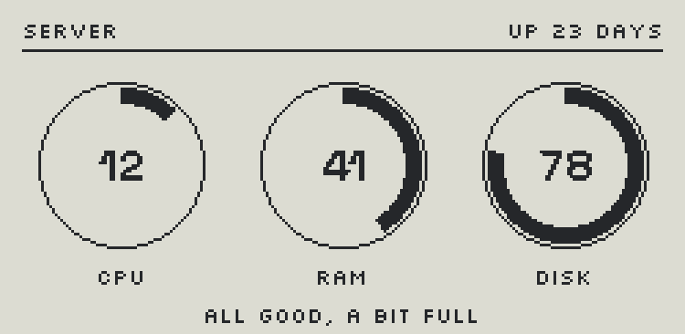 | 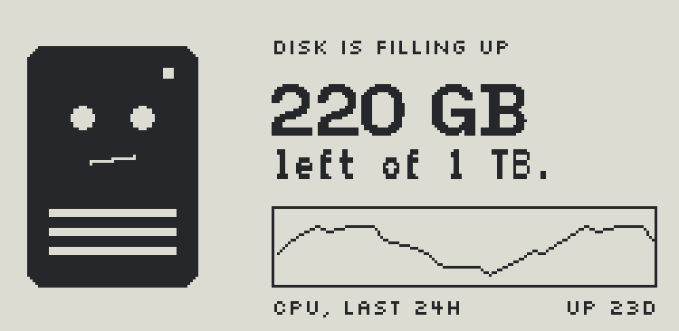 |
| Weather and clock | 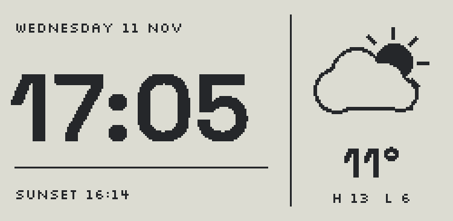 | 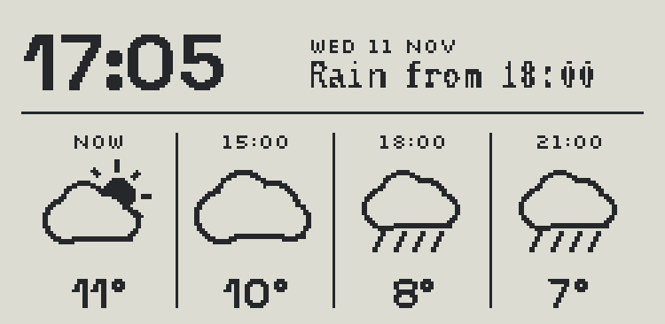 | 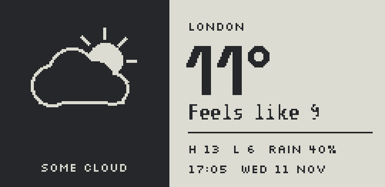 |
| Bin day | 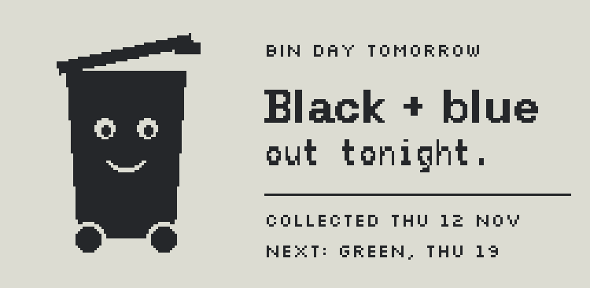 | 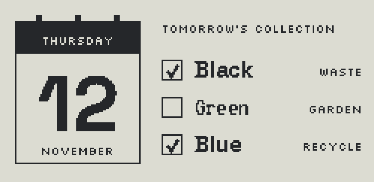 | 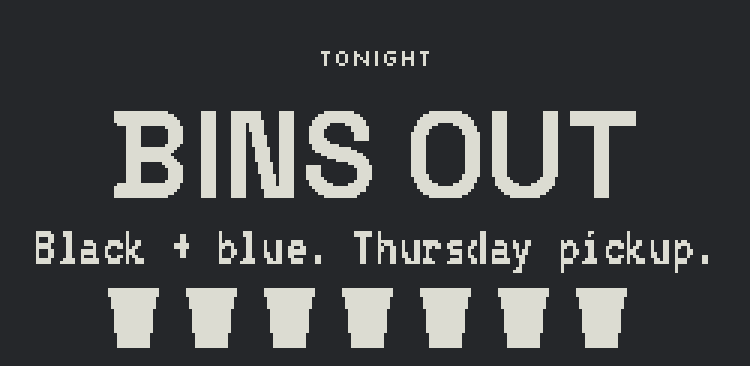 |
| Plants and pets |  | 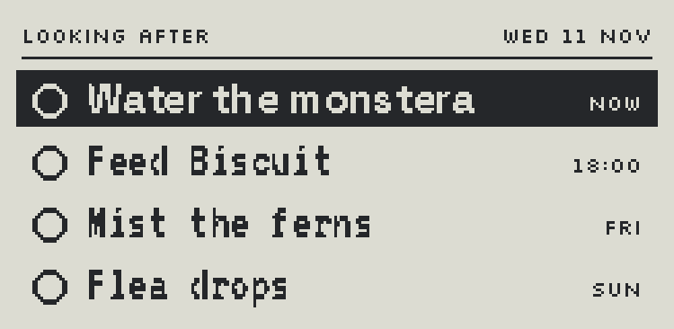 | 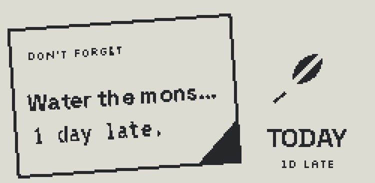 |
| Night mode | 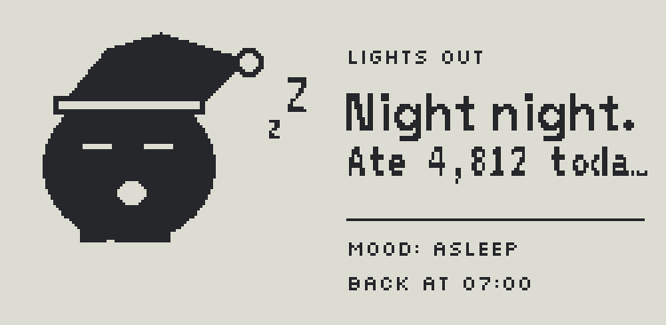 | 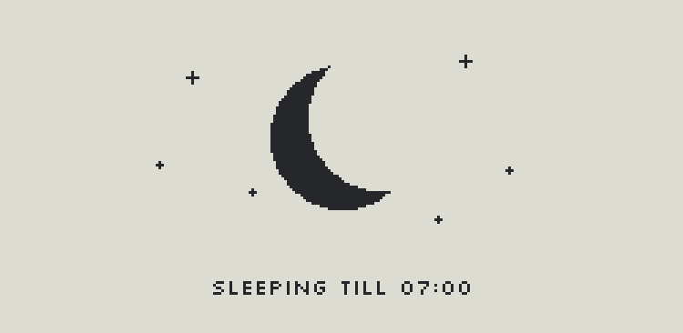 | 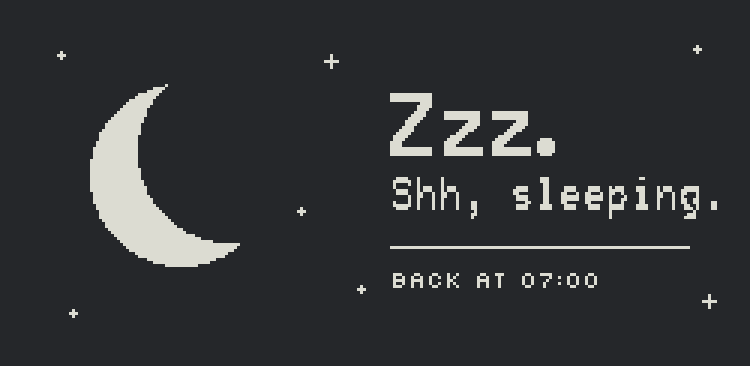 |

- **Weather** comes from [Open-Meteo](https://open-meteo.com): free, no account. Checked every 20 minutes.
- **Server health** reads [Glances](https://github.com/nicolargo/glances), which you install from the ZimaOS app store. It shows the biggest drive, checked every minute.
- **Bin day** shows from 4pm the day before until 10am on the day. You enter each bin's next collection date and how often it goes out.
- **Plants and pets** are reminders you add on the settings page, and tick off there with **Done**.
- **Night mode** shows one quiet screen from 11pm to 7am (change the times on the settings page), then powers the panel down so it isn't refreshed until morning. Music still wakes it for Sleeve unless you turn that off.

## Hardware

- Raspberry Pi Zero W (the Pwnagotchi board)
- Waveshare 2.13in e-Paper HAT, **V4**
- A microSD card, 8 GB or more

## Setup

### 1. Flash the SD card

1. Install [Raspberry Pi Imager](https://www.raspberrypi.com/software/) (version 2 or later).
2. From the [latest release](https://github.com/tlowndes/piholegotchi/releases/latest), download **`piholegotchi.rpi-imager-manifest`**. It's a tiny file that tells Imager where the image is.
3. Double-click it. Imager opens with Piholegotchi in its list. If double-clicking doesn't work, go to **App Options → Content Repository → Edit → Use custom file** and pick it.
4. **Device:** Raspberry Pi Zero (or Zero 2 W). **OS:** Piholegotchi. **Storage:** your SD card.
5. In the settings step:
   - Hostname: `piholegotchi`
   - Username and password: your choice
   - Wi-Fi: your network name and password, country GB. The Pi Zero W only does 2.4 GHz.
   - SSH: optional, only if you want to tinker
6. Write the card.

> Why the manifest file? Imager only offers the Wi-Fi settings step for images it has details about. Picking the image through **Use custom** skips that step, and the Pi wouldn't know your Wi-Fi.

### 2. Boot it

Put the card in and power up. After a couple of minutes the screen shows this:

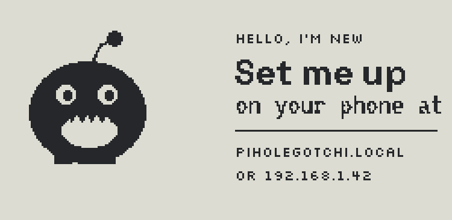

### 3. Open the settings page

On your phone or laptop, go to **http://piholegotchi.local**. If that doesn't load (some Android phones can't do `.local` addresses), type the IP address from the screen instead. You'll see a live view of the screen, plus two sections:

- **AdGuard Home:** the address you open AdGuard's dashboard on, including the port (e.g. `http://192.168.1.20:3000`), and your AdGuard login. Use **Test connection** to check it, then **Save**.
- **Spotify:** follow the four steps on the page. You make a free developer app at [developer.spotify.com/dashboard](https://developer.spotify.com/dashboard), paste its client ID, then sign in. Spotify only sends sign-ins back to secure addresses or to the device itself, so you'll land on a page that doesn't load. Copy that page's address into the last box and press **Finish**.

Further down, pick which screens take turns and their styles, set your town for the weather, your server's Glances address, your bin days, and any plant or pet reminders.

You can come back to this page any time to change any of it.

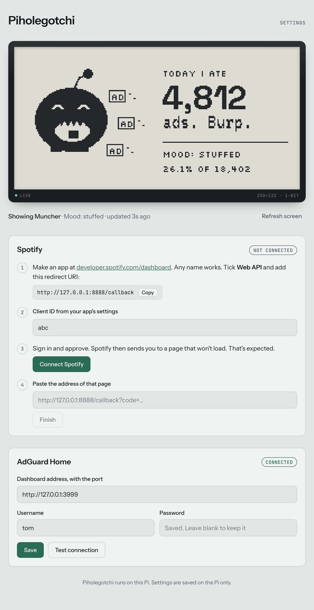

## Other ways to install

**On a Pi that's already running Raspberry Pi OS Lite:**

```sh
sudo apt-get install -y git
git clone https://github.com/tlowndes/piholegotchi.git
cd piholegotchi
./install.sh
```

**Building the image yourself:** every push to `main` runs `.github/workflows/image.yml`, which runs `image/build.sh` and publishes a release. That takes Raspberry Pi OS Lite (32-bit), installs the Python packages in an emulated chroot, copies the app to `/opt/piholegotchi`, and runs it as its own `piholegotchi` user.

## Handy commands

```sh
sudo journalctl -u piholegotchi -f  # watch the logs
python3 -m piholegotchi.spotify_auth  # Spotify sign-in from the terminal, if you'd rather
sudo systemctl stop piholegotchi    # stop (leaves a sleeping face on screen)
python3 -m piholegotchi.preview     # render every screen to ./preview, no hardware needed
python3 -m piholegotchi --png --port 8080   # run on a laptop: writes live.png, settings on :8080
```

## Credits

Fonts are under the SIL Open Font License, see `piholegotchi/fonts/`. The e-ink driver is fetched from [Waveshare's e-Paper repo](https://github.com/waveshareteam/e-Paper) at install time.
