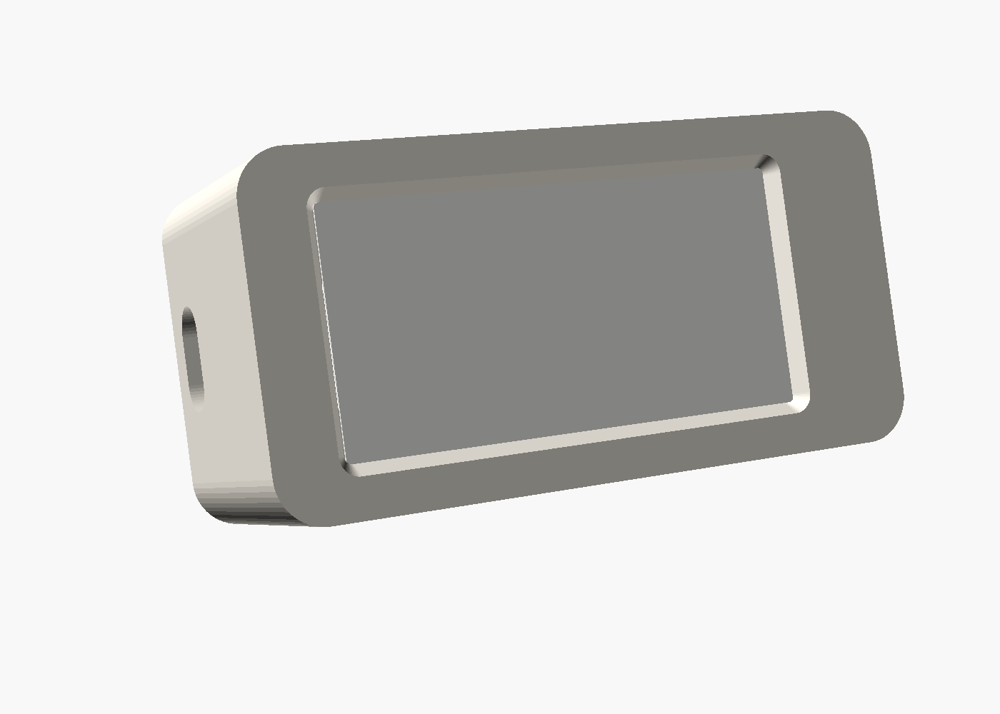
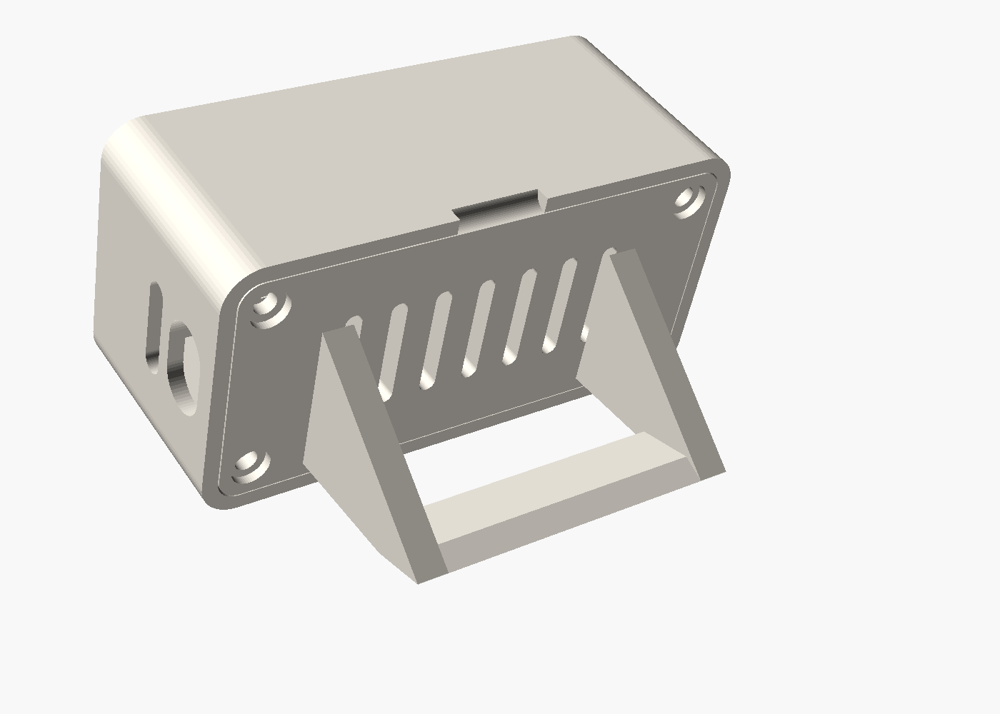

# Piholegotchi case

A 3D-printed desk case for the Piholegotchi: Raspberry Pi Zero W, Waveshare 2.13" e-Paper HAT (V4) and a UPS-Lite V1.2 battery board. It leans back 18° on a foot built into the back plate.




Outside size: about 70 × 35 × 29 mm.

## Parts

| File | What | Print |
|---|---|---|
| `stl/testfit.stl` | Front face only | Print this first (about 10 minutes) to check the window lines up with the screen |
| `stl/front.stl` | Front shell | Face down, no supports |
| `stl/back.stl` | Back plate with foot | Foot up, as exported. The bar between the fins is a short bridge; add supports if your printer struggles |
| `stl/stand.stl` | Optional separate cradle | Only if you set `foot = false` |

PLA or PETG, 0.2 mm layers, 3 walls, 15–20% infill.

## Openings

- **Left end:** UPS-Lite micro-USB (charging and power) and the Pi's SD card.
- **Right end:** UPS-Lite power switch and charge LED.
- The Pi's own micro-USB ports stay covered, because the UPS-Lite powers the Pi. Set `pi_ports = true` to open them.

## Assembly

1. Take out the UPS-Lite's four corner screws.
2. Put the back plate on the UPS-Lite and screw it on with four M2.5 × 8 mm screws, threaded into the UPS-Lite's own standoffs.
3. Push the whole stack into the front shell, screen first, until the back plate clicks in on its four bumps. Use the notch on the top edge to prise it back out.

## Adjusting

Everything is set in `piholegotchi-case.scad` (open it in [OpenSCAD](https://openscad.org), and use the Customiser panel). The values worth checking against your own stack:

- `aa_off_x`: where the window sits along the screen. If the testfit is off, move it by the difference.
- `hat_gap` and `ups_gap`: gaps between the boards, which set the depth.
- `snap`: make it bigger for a firmer click, or smaller if the back is too tight.
- `angle`: how far it leans back.

Export a part from the command line:

```sh
openscad -D 'part="front"' -o stl/front.stl piholegotchi-case.scad
```
