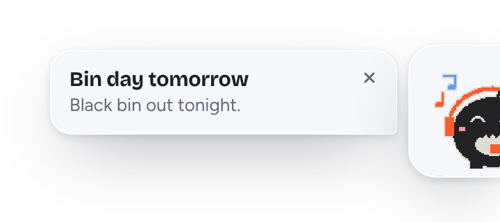
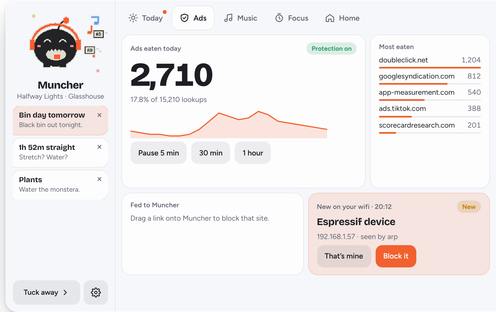
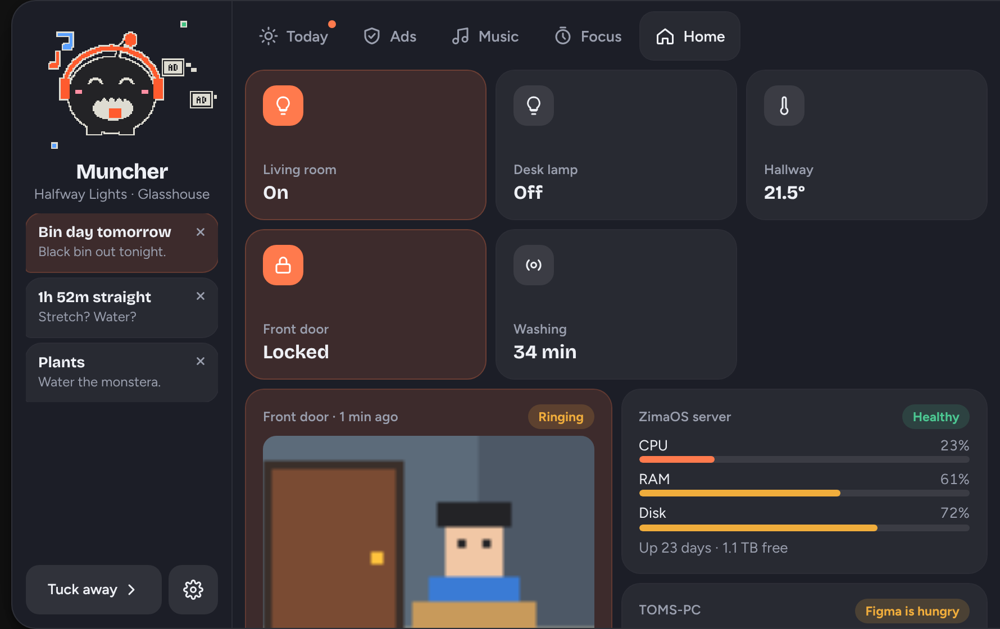

# Muncher for Windows

Piholegotchi v2: Muncher moves off the e-ink shelf and onto a touchscreen monitor as a desk pet. He peeks out from the edge of the screen, always on top. Tap him and a drawer slides out with him inside it, plus five tabs: Today, Ads, Music, Focus and Home.

The widget fetches everything itself, so the Pi is optional. Both can run at once.

<p>
  
</p>
<p>
  
  
</p>

## Install

1. Download `Piholegotchi-Setup-….exe` from the latest `desktop-v2.0.*` release.
2. Run it on the PC with the touchscreen. Windows SmartScreen may warn because the app isn't signed: choose **More info › Run anyway**.
3. Muncher appears on the touchscreen (it's found by its touch support). Tap him, then the cog in the drawer, to open settings.
4. Coming from the Pi: on the Pi's settings page, **Device › Download backup**, then **Load a Pi backup** in the widget's settings. Spotify connects fresh, so the Pi stays signed in.

## Using him

- **Tap** him, or swipe him in from the edge, to slide the drawer out. **Tuck away**, or swipe the drawer back towards the edge, to put it away.
- **Hold** for a moment, then move, to slide him up or down the edge. He remembers the spot. Settings › Muncher picks the left or right edge, and light, dark or system look.
- **Stroke** him to make him purr.
- **Drop a link** on him to feed it to AdGuard (block that domain).
- He speaks up in a bubble when something needs you: bins tonight, a plant due, a break, a doorbell. With the drawer out, the same nudges sit under him.

## Tabs

Tiles for things that aren't connected hide by themselves. Any can be turned off in Settings › Desk › In the drawer.

| Tab | Tiles |
|---|---|
| Today | Weather, Calendar, Messages from Home Assistant, Bins, Plants and pets, Break check and water |
| Ads | Ads (pause, today's top blocks), Snacks (domains you fed him), Who's online (new device alerts) |
| Music | Now playing (Spotify, Premium for controls), Sound (media keys and per-app volume), On repeat (top tracks over four weeks) |
| Focus | Focus timer, Flight Deck day, Streaks and levels, Quick capture to Obsidian (type or dictate), Clipboard shelf, Monday report card |
| Home | Home Assistant tiles, Doorbell snapshot, Server health (Glances), This PC |

### Moods

All the Pi's moods (hungry, content, stuffed, party, starving, snoozing, asleep) plus a few new ones: focus, night, shh (meeting), purr, stretch (break due), drift (wandered off during Focus) and sus (a new device on the wifi). He wears a crown on a five-day focus streak and shades from level 6.

## Flight Deck and Home Assistant

The widget listens on port 8787 (changeable in settings), with the same endpoints as the Pi:

| Endpoint | Use |
|---|---|
| `POST /api/deck` | Flight Deck's day and Focus sessions |
| `POST /api/message` | `{"text": "…"}` from a Home Assistant automation |
| `POST /api/doorbell` | Shows the doorbell snapshot straight away |
| `GET /api/status` | Muncher's mood, to check it's up |

Settings › Desk lists this PC's addresses. Allow private networks when Windows asks.

## Developing

```
cd desktop
npm install
npm run demo     # fake data, no connections needed
npm start        # the real thing
npm test
npm run dist     # Windows installer into dist/ (on Windows)
```

- `main/` is the Electron main process: `hub.js` polls every source and works out the mood and nudges; `sources/` has one file per service; `win/helper.ps1` is a small PowerShell helper for media keys, volume, the active window and mic or camera use.
- `renderer/` is the widget (`widget.*`, `muncher.js`, `screens.js`) and the settings window (`settings.*`).
- Passwords and tokens are encrypted with Windows' per-user encryption (Electron `safeStorage`).
- Pushes that touch `desktop/` build the installer on GitHub Actions. On `main` it's published as a `desktop-v2.0.N` release.
