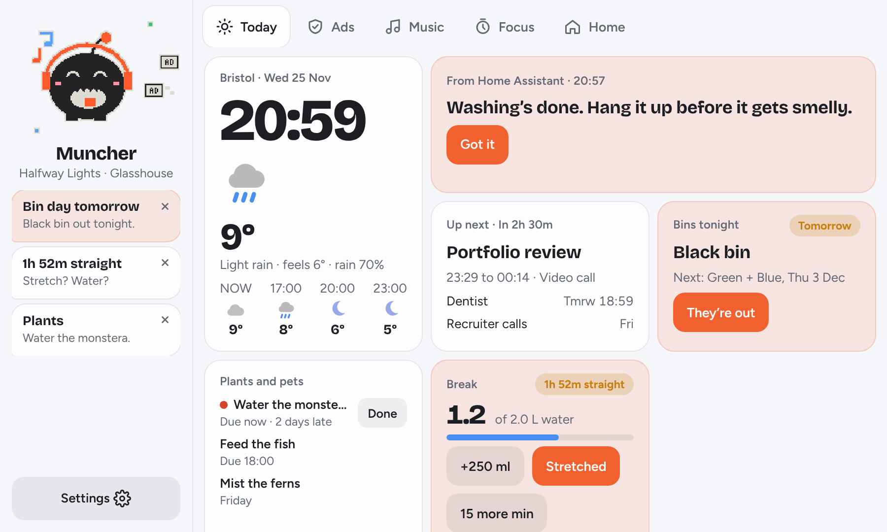
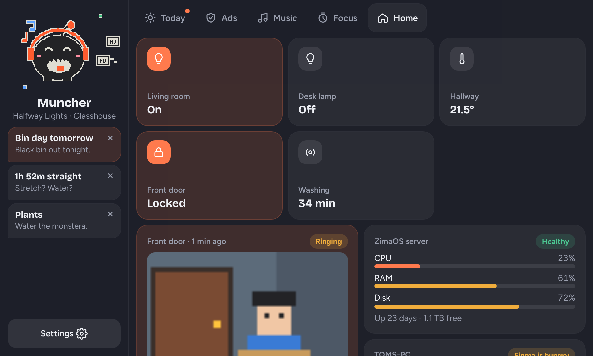

# Muncher for Windows

Piholegotchi v2: Muncher moves off the e-ink shelf and into a window on your PC. Pop it on your smaller screen when you want him: him and his nudges on the left, five tabs on the right (Today, Ads, Music, Focus, Home). Close it and he waits in the tray.

The widget fetches everything itself, so the Pi is optional. Both can run at once.

<p>
  
  
</p>

## Install

1. Download `Piholegotchi-Setup-….exe` from the latest `desktop-v2.0.*` release.
2. Run it on the PC with the touchscreen. Windows SmartScreen may warn because the app isn't signed: choose **More info › Run anyway**.
3. Muncher's window opens on your second screen (a touchscreen if there is one). Drag it wherever you like and resize it; it opens there next time. **Settings** is under him.
4. Coming from the Pi: on the Pi's settings page, **Device › Download backup**, then **Load a Pi backup** in the widget's settings. Spotify connects fresh, so the Pi stays signed in.

## Using him

- **Close** the window and he hides in the tray, so Flight Deck, nudges and updates keep working. Click the tray icon to bring him back. (Settings › Muncher can make closing quit instead.)
- **Stroke** him to make him purr.
- **Drop a link** on him to feed it to AdGuard (block that domain).
- Nudges (bins tonight, a plant due, a break, a doorbell) sit under him. While his window is hidden they come as Windows notifications.
- Settings › Muncher picks which screen he opens on, light or dark, the size of everything, and whether he stays on top.

## Tabs

Tiles for things that aren't connected hide by themselves. Any can be turned off in Settings › Desk › In his window.

| Tab | Tiles |
|---|---|
| Today | Weather, Calendar, Messages from Home Assistant, Bins, Plants and pets, Break check and water |
| Ads | Ads (pause, today's top blocks), Snacks (domains you fed him), Who's online (new device alerts) |
| Music | Now playing (Spotify, Premium for controls), Sound (media keys and per-app volume), On repeat (top tracks over four weeks) |
| Focus | Focus timer, Flight Deck day, Streaks and levels, Quick capture to Obsidian (type or dictate), Clipboard shelf, Monday report card |
| Home | Home Assistant tiles, Doorbell snapshot, Server health (Glances), This PC |

### Moods

All the Pi's moods (hungry, content, stuffed, party, starving, snoozing, asleep) plus a few new ones: focus, night, shh (meeting), purr, stretch (break due), drift (wandered off during Focus) and sus (a new device on the wifi). He wears a crown on a five-day focus streak and shades from level 6.

## Flight Deck and Home Assistant

The widget listens on port 8787 (changeable in settings), with the same endpoints as the Pi:

| Endpoint | Use |
|---|---|
| `POST /api/deck` | Flight Deck's day and Focus sessions |
| `POST /api/message` | `{"text": "…"}` from a Home Assistant automation |
| `POST /api/doorbell` | Shows the doorbell snapshot straight away |
| `GET /api/status` | Muncher's mood, to check it's up |

Settings › Desk lists this PC's addresses. Allow private networks when Windows asks.

## Developing

```
cd desktop
npm install
npm run demo     # fake data, no connections needed
npm start        # the real thing
npm test
npm run dist     # Windows installer into dist/ (on Windows)
```

- `main/` is the Electron main process: `hub.js` polls every source and works out the mood and nudges; `sources/` has one file per service; `win/helper.ps1` is a small PowerShell helper for media keys, volume, the active window and mic or camera use.
- `renderer/` is the widget (`widget.*`, `muncher.js`, `screens.js`) and the settings window (`settings.*`).
- Passwords and tokens are encrypted with Windows' per-user encryption (Electron `safeStorage`).
- Pushes that touch `desktop/` build the installer on GitHub Actions. On `main` it's published as a `desktop-v2.0.N` release.
